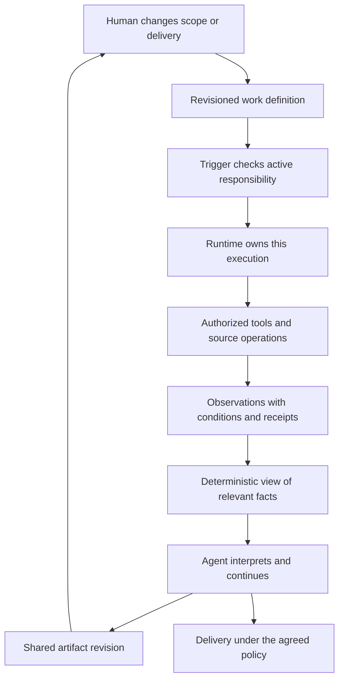
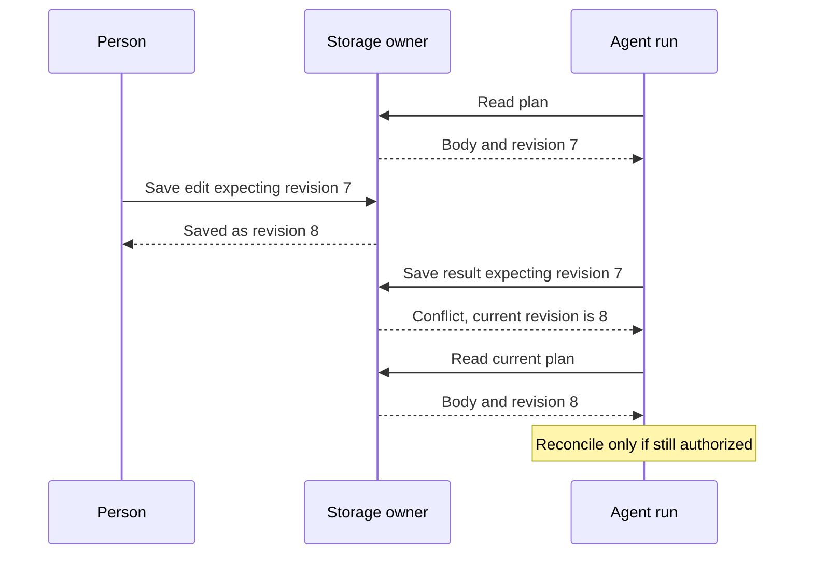
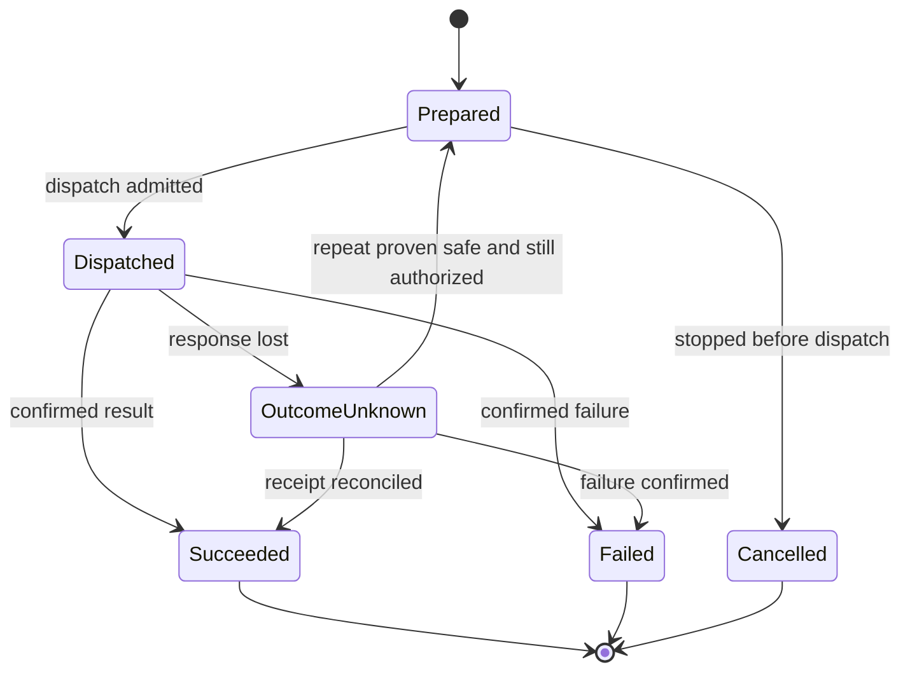

# An Agent Run Ends. The Work Does Not.

*2026-11-03 · agent harnesses · durable work · data contracts · concurrency · programmatic tool use*

We built an assistant that could run in the background. It could inspect information, use tools, and send updates. In my own account, I gave it a concrete recurring task, so it appeared to work. Then someone told me that their assistant had been silent.

I checked another account. They were right.

My first interpretation was that we needed a more proactive agent. The deeper problem was less flattering: I had not made its responsibility sufficiently explicit. A conversation contained useful context, but it did not necessarily establish what the assistant should keep doing, which objects it should maintain, or what counted as a useful update.

That failure changed the questions we asked. We started with prompts, browser operations, tools, and scheduled runs. We gradually found ourselves working on shared records, editable documents, observation history, and the conditions under which an old result could still be used.

Some of this looked suspiciously like ordinary business software. I worried that we were making the project heavier while moving away from a clean agent harness. Yet a person returning tomorrow needs more than another successful model invocation. They need the work to have retained its meaning.

This essay explains that shift through implementation decisions. The examples and identifiers below are synthetic. They are reference designs, not a description of a complete deployed platform. Where a method remains a proposal, I say so. I am not claiming a measured improvement in reliability or cost for the combined design.

## A successful run can leave the next run with nothing to do

Consider a small recurring job: maintain a list of items, collect a measurement for each, update a review sheet, and report changes that need attention.

One run might complete perfectly. It reads an attachment, queries the source, calculates the differences, and returns a new workbook. Tomorrow, several questions remain:

- Did the user ask for another run, or only for this file?
- Which list is now authoritative: the original attachment, the edited sheet, or a remembered list in the conversation?
- If someone changes the region halfway through collection, which region does the result describe?
- Does removing an item stop future work, delete its history, or both?
- If the source request times out, is the measurement absent, failed, or still running elsewhere?

Putting more conversation into the next prompt does not resolve these questions. The system needs explicit answers that survive a particular run.

The smallest useful distinction is between **a continuing responsibility** and **one execution of that responsibility**. A successful execution does not revoke the responsibility. A failed execution does not mean that the user withdrew it. Saving an artifact does not authorize recurring collection.

These distinctions also change the user interface. A chat can establish an intention. A table can make the maintained scope visible. A document can hold an agreed plan. A background job can perform the next collection. Each is useful when it reduces the effort of completing the same work.

We stopped treating a fixed interface as evidence that the agent had failed. If a person needs to remove one tracked item, a visible row and a clear action may be better than making them describe the row again. The agent should use the same operation as the interface, under the same authorization rules.

## Give each kind of state one owner

The term *memory* was too broad for the things we were trying to preserve.

A human agreement, a source measurement, a shared document, and an execution checkpoint all persist. Their update rules differ. Combining them in one mutable summary makes those differences harder to enforce.

A useful starting model has four records:

| Record | What it means | How it changes |
| --- | --- | --- |
| Work definition | What should continue, for whom, over which scope, with which delivery expectation | Explicit authorized changes create a new revision |
| Observation | What a source reported under specific conditions | Preserve the original result; append a new observation or correction |
| Shared artifact | A plan, sheet, or document that people and agents edit | Save a revision and check the expected base revision |
| Execution | What this particular attempt has started, completed, or left unresolved | The runtime advances its own lifecycle |

An observation is evidence about the world. A work definition is an instruction about what to do. Editing the latter must not rewrite the former.



This diagram describes ownership, not a requirement to build another workflow engine. If a framework already owns tool execution, suspension, recovery, and terminal states, use that owner. The application still owns the meaning of an active responsibility and the authorization to change it.

The work definition can begin as a few ordinary relational records. It does not require a graph database, an ontology platform, or a general event bus. Introduce a new mechanism only when the existing representation fails a concrete lifecycle or query requirement.

An agent can participate in a shared workspace through the same domain operations as a person. That does not make the agent a new source of authority. The server must still check its effective principal, tenant, object permissions, and permitted action.

## A fact needs conditions before it needs a confidence score

Another tempting simplification was to rank entire information channels: database above notes, internal API above web, structured result above prose.

That hierarchy fails as soon as the question changes. A note may be the authoritative record of a decision. It cannot establish today's measured quantity. A database can store a stale estimate just as reliably as a fresh observation. An API response may be correct for a different region or reporting period.

The transport tells us how information arrived. It does not establish what the information proves.

For a measurement, I now want a contract that makes its applicability inspectable:

```json
{
  "observation_id": "obs-example-42",
  "subject_id": "item-example-7",
  "metric": "search_position",
  "conditions": {
    "region": "region-example",
    "query": "example phrase",
    "device": "desktop",
    "maximum_position": 100
  },
  "observed_at": "2026-11-02T09:00:00Z",
  "retrieved_at": "2026-11-02T09:00:03Z",
  "source": {
    "adapter": "example-search-source-v1",
    "receipt_id": "request-example-19"
  },
  "result": {
    "kind": "not_found_within_scope",
    "searched_through": 100
  }
}
```

This says that the item was not found within the inspected range. It does not say that it has no position anywhere. It does not contain a numeric zero to stand in for an unknown position.

For period-based metrics, the contract also needs the source period and timezone. Retrieval time is not the same as the time the underlying data describes. A freshness policy must know which clock it is evaluating.

The result type should distinguish at least the states that change the next action. For this example, those might be a measured position, a valid bounded absence, a failed collection, and an unattempted item. Another metric may legitimately return a measured zero. The distinction belongs in its schema and domain logic.

This is more useful than attaching a generic confidence number to everything. The decisive question is often whether the result answers this particular question under these particular conditions.

### There is more than one meaning of “latest”

Suppose yesterday's collection succeeded and today's attempt failed.

The latest attempt is a failure. The latest valid measurement is yesterday's result. A view answering “what happened in this run?” must show the failure. A view answering “what is the last known measurement?” may show yesterday's value, with its age and conditions visible. A question asking for the current value may require another collection or an explicit statement that the current value is unavailable.

These are different selectors over the same history:

| Operation | Selection rule |
| --- | --- |
| Inspect an execution | Results and failures linked to that execution |
| Show the last known value | Most recent compatible valid observation, with age exposed |
| Answer a current-value question | Compatible observation satisfying the operation's freshness policy, otherwise collect or report the gap |
| Build a daily trend | A documented representative rule within each day's observations |
| Export history | All authorized matching observations in the requested interval |

A “best result of the day” can be appropriate for one trend. It must not silently become the latest result everywhere. A common business date alone is also insufficient to guarantee freshness.

I would rather keep several small, accurately named queries than one universal `latest()` function whose flags reconstruct all these meanings.

## Human edits and agent runs meet at a version boundary

The next failure is a race.

An agent starts with revision 7 of a shared plan. While it collects information, a person saves revision 8. The agent returns later and saves its rewritten copy of revision 7. Without a version check, a useful human change disappears.

Longer context does not prevent this. The agent may never have seen revision 8.

The run should pin the revision it read. A write should state the revision it expects to replace. The storage owner then compares the expectation with the current value in the same atomic operation.

Here is a minimal SQLite illustration:

```sql
CREATE TABLE shared_plan (
    workspace_id TEXT NOT NULL,
    plan_id      TEXT NOT NULL,
    revision     INTEGER NOT NULL CHECK (revision > 0),
    body         TEXT NOT NULL,
    PRIMARY KEY (workspace_id, plan_id)
);

UPDATE shared_plan
SET body = :new_body,
    revision = revision + 1
WHERE workspace_id = :workspace_id
  AND plan_id = :plan_id
  AND revision = :expected_revision;
```

The caller must check the affected-row count. One row means the update matched. Zero means it did not. SQLite explicitly allows an `UPDATE` to affect zero rows without raising an error, so “the SQL call succeeded” is insufficient evidence that the save occurred. [SQLite UPDATE documentation](https://www.sqlite.org/lang_update.html)

Authorization is a separate prerequisite. Matching `workspace_id` is not itself a permission check. The server must derive and verify the permitted workspace before executing the update. If saving also creates a revision-history record, both writes belong in one transaction.



A conflict is a real work outcome. The agent can reread and propose a reconciliation, or leave its output as a separate draft. Blindly retrying the same overwrite would defeat the check.

SQLite transactions can make the local writes atomic. They cannot make a remote action part of that local transaction. Network calls should not sit inside a long write transaction; SQLite also permits only one simultaneous writer. [SQLite transaction documentation](https://www.sqlite.org/lang_transaction.html)

The same principle applies to a changed work definition. A late observation may still be valid evidence under the old conditions and worth retaining. It must retain those conditions. It must not overwrite the new scope or reactivate work that a person stopped.

## A timeout leaves an outcome to reconcile

Consider a source that starts a remote job. The request reaches the server, the server starts the job, and the connection breaks before the client receives the identifier.

An agent sees a timeout. It is easy to interpret that as “nothing happened” and try again. The second request can create a second job.

The crucial state is **outcome unknown**. It differs from failure before dispatch and from a confirmed remote failure.

An application that supports side effects needs to decide how it represents that uncertainty. One reference design records the intended operation before dispatch and, where supported, sends a stable idempotency key for that same operation. The key is reused during reconciliation or retry; it is not regenerated each time the agent asks again.

The server must bind the key to the caller and request parameters, reject incompatible reuse, and define its retention window. A local key with no corresponding remote contract cannot prevent a remote duplicate. AWS's account of idempotent APIs explains why caller-provided request identifiers and atomic recording of the identifier with the operation matter. [AWS Builders' Library](https://aws.amazon.com/builders-library/making-retries-safe-with-idempotent-APIs/)

HTTP has its own definition of idempotent methods. That does not make every agent tool safe to repeat: a tool may create a job through `POST`, charge for a collection, or perform several operations internally. Its application contract must establish what repeating it means. [RFC 9110, section 9.2.2](https://www.rfc-editor.org/rfc/rfc9110.html#section-9.2.2)



The transition back to `Prepared` needs evidence. It may be safe because the remote service honors the original idempotency key, or because the original request was confirmed not to have taken effect. “The agent would like to try again” is not enough.

Cancellation has a related boundary. Stopping a run should stop admitting new work for that run and propagate cancellation to operations that support it. An in-flight remote action may still finish. Its eventual receipt must be settled under the original operation and ownership, without pretending that disconnecting the browser rolled it back.

There is also a business distinction: cancelling this execution and withdrawing the continuing responsibility are separate actions. A person may want today's attempt stopped while keeping tomorrow's schedule. They may also want to stop only one subset of the maintained scope.

This is why I prefer a runtime with a clearly owned execution lifecycle. Rebuilding that lifecycle in a parallel application status system creates another place where “stopped,” “failed,” and “completed” can disagree.

## Move stable transformations out of the model's retelling

We encountered a particularly instructive class of error: collection succeeded, records were saved correctly, and the final answer still misrepresented the results.

A valid bounded absence became an unverified item. A period changed in the explanation. A statement about the inspected page became a statement about the entire search space.

Fixing storage did not fix these errors because storage was already correct. The first wrong boundary was the transformation from structured results to human-visible facts.

For fixed facts, the application can derive a stable view directly from the execution-linked observations. The model can then explain implications, uncertainty, and possible next steps using that view.

For example, a batch result might contain these synthetic outcomes:

```json
[
  {"item_id": "a", "kind": "measured", "value": 12},
  {"item_id": "b", "kind": "not_found_within_scope", "searched_through": 100},
  {"item_id": "c", "kind": "failed", "reason": "source_timeout"}
]
```

The fixed summary is one measured result, one valid bounded absence, and one collection failure. That summary is a program output. The model should not have to count the rows again to decide which facts the interface displays.

There is still substantial work for the model: does the change matter, which additional evidence could change the interpretation, and what should the person do next? A verified measurement does not establish its cause. The design should keep that distinction visible.

We found three useful execution forms:

| Form | Suitable work | Responsibility that remains |
| --- | --- | --- |
| Fixed domain function | Confirmed formulas, decision relationships, validation, repeatable transforms | Keep the business relationship correct and versioned |
| Agent-written tool composition | Loops, joins, conditional collection, assembling existing capabilities | Bound execution and inspect each operation's result |
| File-processing program | Workbook edits, large datasets, plots, exported artifacts | Verify the actual output file and preserve file ownership |

These forms can cooperate in one task. They do not need three competing runtimes.

Programmatic tool use is useful when intermediate data can stay in an execution environment and only the needed result must enter model context. Anthropic describes this pattern for MCP through on-demand tool discovery, filtering, and ordinary control flow. That is an implementation precedent, not a benchmark for our application. [Code execution with MCP](https://www.anthropic.com/research/code-execution-with-mcp)

The safety boundary remains outside generated code. The environment should expose authorized capabilities, enforce isolation and resource limits, and retain necessary receipts. Generated orchestration must not acquire broader permissions merely because it runs as code.

It also needs a structured return contract. A process exiting with code zero proves that the process finished successfully according to its own convention. An inner tool may still have returned an error object. A loop may have completed only part of the batch. The result should expose requested, attempted, succeeded, failed, and unresolved items so that the next step can account for them.

Moving work into code reduces opportunities for repeated interpretation. It does not remove the need to check business outcomes.

## Methods should shorten the path to an operation

Once an agent has many capabilities, the next temptation is to organize them into more documents and routing layers.

There is a reasonable case for doing so. A short resident prompt cannot contain every procedure. Specialized methods can preserve lessons and load only when relevant. A broad task may need a reusable approach that no single tool schema describes.

But we also designed a candidate in which the agent could first select a general working mode, then a playbook, then a domain method, and only then discover the operation. Reviewing that design exposed an uncomfortable possibility: we were organizing the documentation more neatly while making the work harder to reach.

The next candidate removes the general mode as a prerequisite. A direct question can reach a known tool. A familiar domain task can load its domain method. An unfamiliar composite task can load a method for decomposing and checking the work.

That revision is still a design hypothesis until comparable model runs establish its effect. Fewer documents or fewer navigation steps do not, by themselves, prove better task performance.

The useful unit is an executable method. For example:

```text
Use when: continuing a previously saved measurement task.

1. Resolve the stable work ID and read its current revision.
2. Confirm that the requested action is inside the active scope.
3. Distinguish reading saved results from collecting new results.
4. Load the exact source operations required for collection.
5. Preserve per-item outcomes and source receipts.
6. Derive fixed facts from the selected observations.
7. Save an artifact against its expected revision.
8. Deliver the agreed result, including unresolved work.
```

This is a synthetic outline. A real method also needs the exact available operations and the parameters whose meaning changes the result. “Fetch the data and analyze it” leaves nearly all the engineering decisions unresolved.

Tool schemas should own structural validation and declared defaults. Methods should explain semantic prerequisites: which period answers the question, when a new collection is necessary, and what to do after partial completion. If a method requires a fourteen-day comparison while the invoked operation silently defaults to one day, shortening the method has made it worse.

Progressive loading therefore has two costs to balance. Loading everything wastes context. Excessive fragmentation creates repeated discovery and opportunities to choose the wrong path. One additional loading round can reduce total work if it prevents a mistaken collection or an unusable artifact.

I would measure the whole task: correct delivery, elapsed time, model and tool cost, and human repair. Prompt length is one input to that result.

## Parallel work does not imply a team of agents

Batch processing exposed another ambiguity. “Scale the agent” can mean several different things:

- More items inside one job.
- More jobs from independent users.
- More kinds of business work to maintain.
- More historical records to query.

Each has a different limiting resource. Adding agent instances may help one and worsen another.

If one job checks hundreds of independent items through known operations, a bounded worker pool may be enough. The agent decides what to collect and interprets the result. Ordinary code schedules the item operations under the source's concurrency and rate limits.

An idealized lower bound helps explain why worker count alone is insufficient:

```text
completion time >= max(
    total service work / available workers,
    dependency-chain duration,
    request count / allowed request rate
)
```

This is a capacity argument, not a latency prediction. It omits queueing, startup, retries, variable item duration, and other resource limits. Increasing workers cannot remove a serial dependency or a source rate limit.

Independent users need a different boundary: fair admission, isolated cancellation, and correct data ownership. Two tasks that use the same source do not automatically have permission to share account state or results.

There can still be safe reuse. If authorized consumers request the same public measurement under equivalent conditions and freshness requirements, one collected observation may satisfy both. The equivalence key must include the parameters that affect the result, the source semantics, and the permitted sharing scope. Private interests and delivery policies remain separate.

The difficult engineering work is often defining equivalence correctly. Two identical query strings can still differ by region, device, account, search depth, or time. Deduplicating them too early saves requests by answering a different question.

More kinds of business work present a maintenance problem. A nearby task should ideally add a domain operation, a schema, or a method while reusing execution, persistence, and delivery mechanisms. If every new capability requires editing several competing snapshots of the same state, local patches will accumulate faster than the product's useful behavior.

That does not imply constant code size. New behavior has a real cost. The aim is to avoid multiplying lifecycle ownership with every feature.

## Evaluate the work that comes back, including the next turn

A design can look coherent while failing its original story. We need evidence at several levels, and each level answers a different question.

A source audit can establish that an SDK supports batch loading. A local probe can show that the installed mechanism works. Neither establishes that the model chooses the right method or returns a correct workbook.

Likewise, an external review is a set of claims to investigate. A useful review can reveal a genuine missing operation and still make an incorrect assumption about another part of the code. Accepting its useful criticism does not require turning every criticism into a historical fact.

For this work, the important tests cross boundaries:

| Scenario | What the evidence must show |
| --- | --- |
| A saved note disagrees with a fresh measurement | The answer uses the appropriate source for the question and preserves what the note actually establishes |
| The newest attempt failed | The current-run failure is visible; an older valid result is not silently presented as current |
| A person edits while the agent runs | The stale save cannot overwrite the newer revision |
| A batch partly completes | Successful observations survive; failures and unresolved items remain individually identifiable |
| A remote response is lost | The original operation is reconciled or a safe retry is justified |
| One tracked subset is stopped | The stop does not spread to unrelated responsibilities or erase history |
| A generated workbook is delivered | The file opens, required sheets and formulas remain, and key calculations match the source inputs |
| A simple request needs no workflow | The agent can answer without performing unnecessary method discovery or business operations |

For model comparisons, keep shared correctness fixes in both baselines. Otherwise an experiment advertised as a routing comparison may really be measuring a repaired tool contract. Hold the model configuration, input data, available capabilities, language, and budget comparable. Inspect cold loading separately from a conversation where the method is already loaded.

The evidence should include the natural request, actual tool arguments and results, saved observations, delivered artifact, and complete visible answer. A successful trace ending beside an incorrect file is still a failed delivery. A correct file accompanied by a misleading explanation is also a defect worth preserving.

No single metric settles this. High cache hit rate can coexist with unnecessary rounds. A fast answer can omit required work. More input tokens can sometimes accompany less reasoning and a faster correct result. The comparison needs the same user outcome and a clear accounting boundary.

## What I would build next

I used to think the central question was how much more of the work we could give to the model.

I now ask what the next person or agent would need in order to continue without reconstructing the entire history.

For a small system, I would start with one visible maintained scope, one revisioned shared artifact, and observations that retain their source conditions. I would make one complete workflow pass through those records, including a human edit and a partial failure. Then I would add the next recurring action through the same operations.

I would borrow execution and recovery mechanisms from an existing runtime wherever they satisfy the real lifecycle. I would keep confirmed transformations in ordinary code, let the agent compose capabilities when the task requires it, and load methods that explain how to reach a verifiable result. More elaborate routing and delegation would need their own evidence.

The next run should be able to say: this is the current scope, these are the observations that apply, this changed while I was working, this action is still unresolved, and this is the artifact I actually saved.

That is a concrete form of continuity. It also gives us a way to tell whether the assistant is doing its job when we are not watching.
